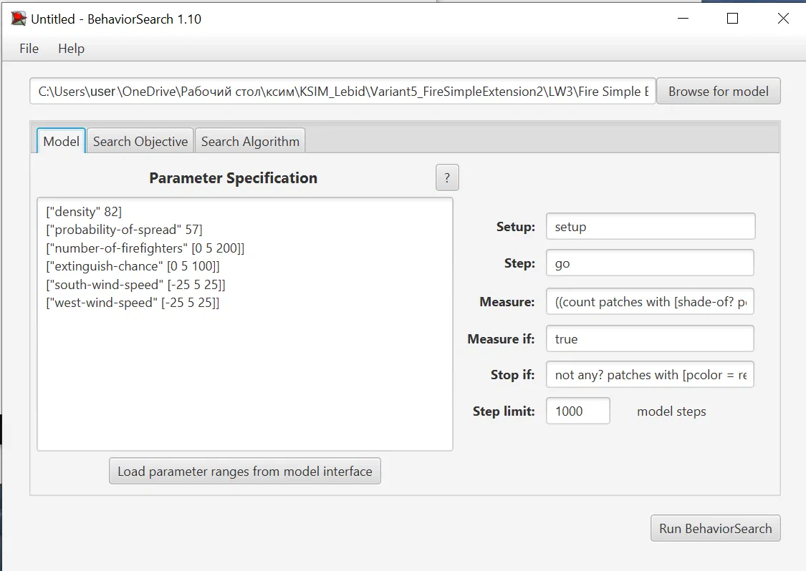
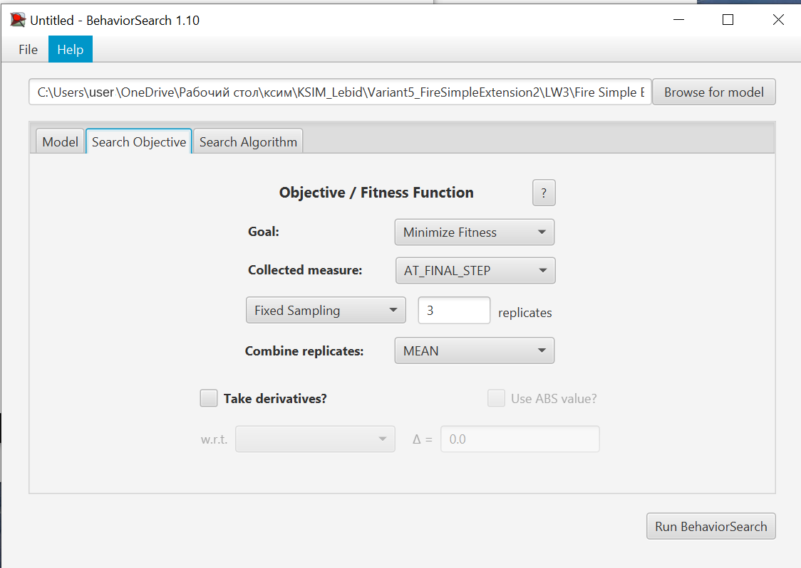
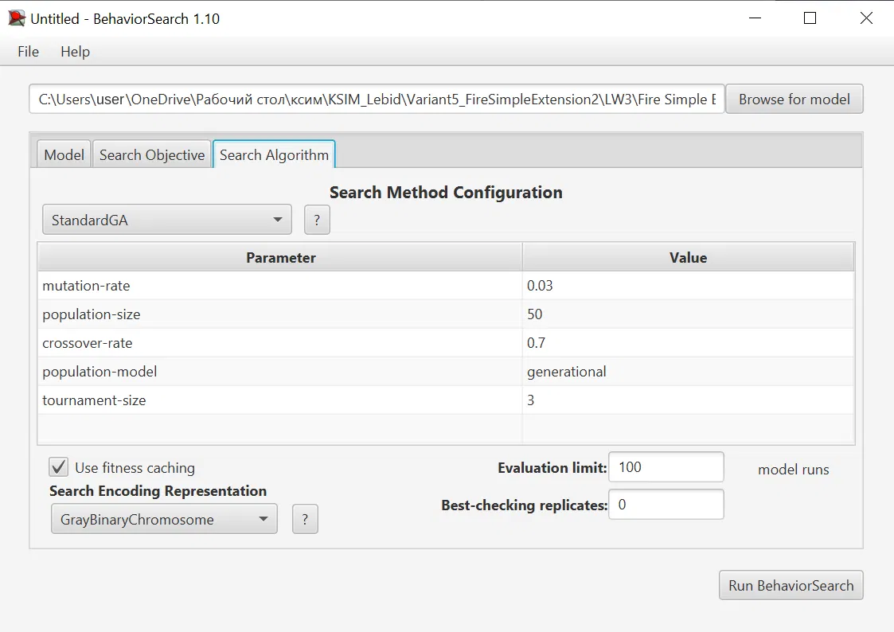
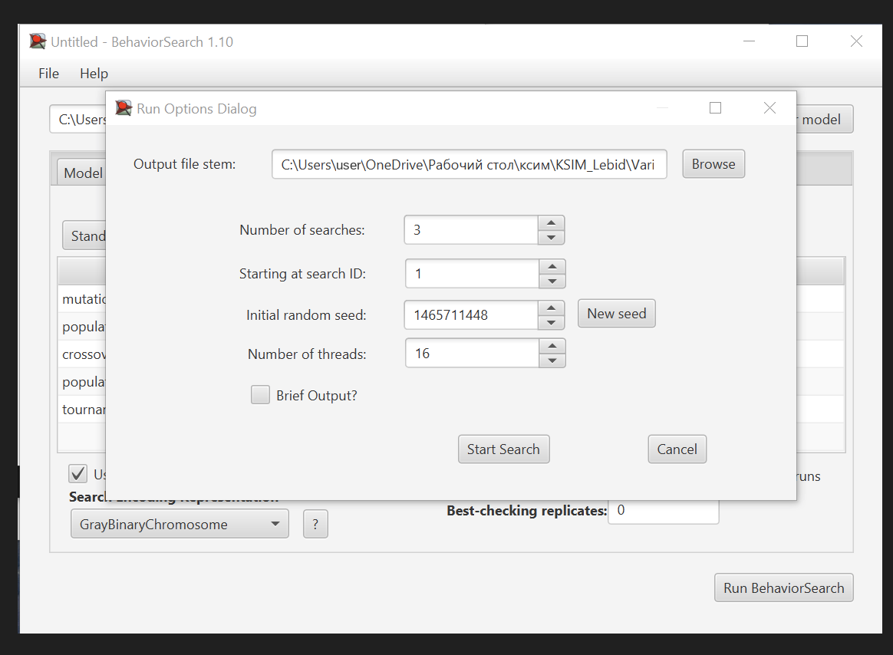
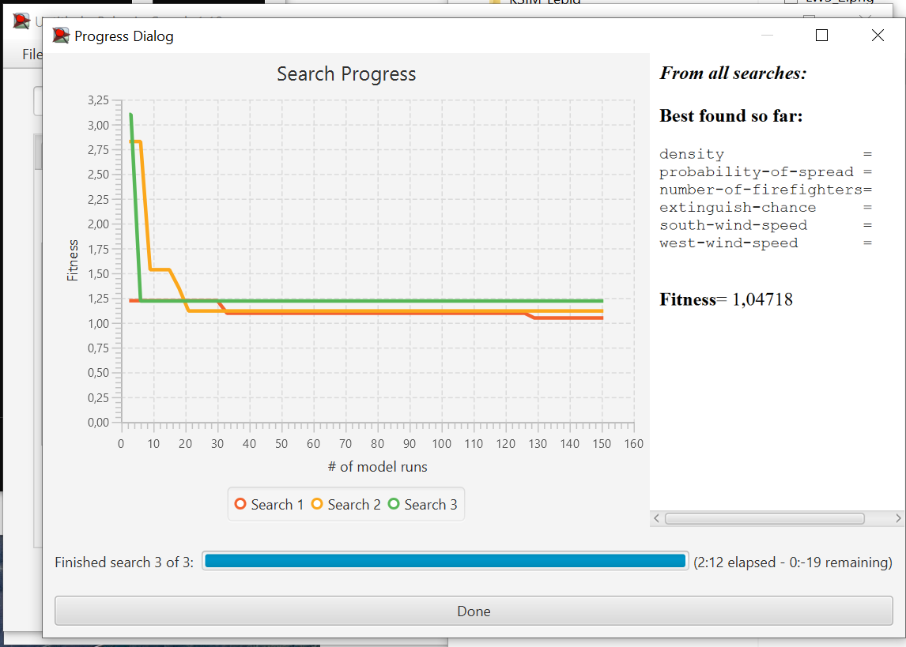
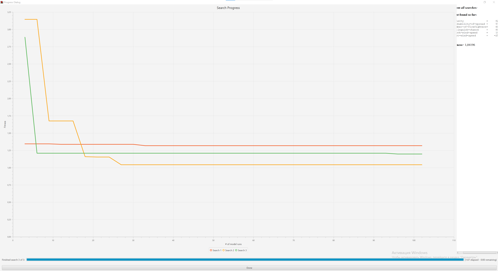
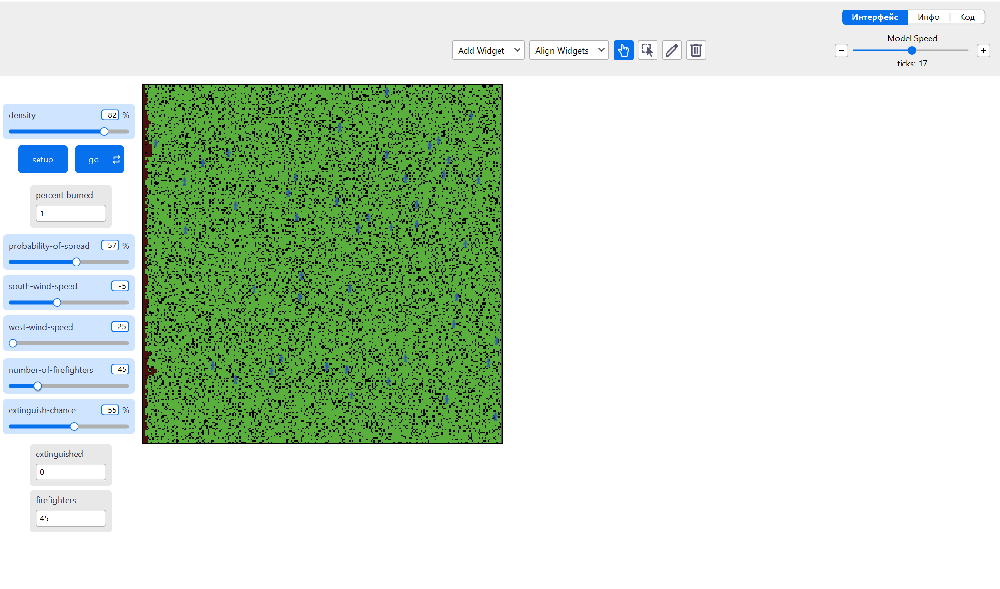

# Комп'ютерні системи імітаційного моделювання

## СПм-25-2, **Лебідь Іван Сергійович**

### Лабораторна робота №**3**. Використання засобів обчислювального інтелекту для оптимізації імітаційних моделей

 

### Варіант 5, модель у середовищі NetLogo:
[Fire Simple Extension 2](http://www.netlogoweb.org/launch#http://www.netlogoweb.org/assets/modelslib/IABM%20Textbook/chapter%203/Fire%20Extensions/Fire%20Simple%20Extension%202.nlogo) - у версії, доопрацьованій у лабораторній роботі №2 (файл [Fire Simple Extension 2_modified.nlogox](Fire%20Simple%20Extension%202_modified.nlogox)).

 

#### Вербальний опис моделі:
Модель поширення лісової пожежі на полі 251 × 251 ділянка. Дерева (зелені ділянки) розміщені випадково із заданою щільністю; вогонь стартує на всій лівій межі поля й поширюється на чотирьох сусідів з імовірністю `probability-of-spread`, яку збільшує вітер, що дме у бік сусіда, і зменшує вітер проти. У доопрацьованій версії в лісі працюють пожежники (сині агенти): вони випадково блукають по незгорілих ділянках та гасять сусідні осередки вогню з імовірністю `extinguish-chance`. Детальний опис логіки та змін - у звітах до лабораторних робіт №1 та №2.

#### Керуючі параметри:
- **density** - щільність лісу, %.
- **probability-of-spread** - базова імовірність передачі вогню сусідньому дереву, %.
- **south-wind-speed**, **west-wind-speed** - швидкість південного та західного вітру (від'ємні значення - протилежні напрямки).
- **number-of-firefighters** - кількість пожежників.
- **extinguish-chance** - імовірність того, що пожежник загасить палаючу ділянку поруч, %.

#### Показники роботи моделі:
- **percent burned** - відсоток згорілих дерев (відношення кількості ділянок червоного відтінку до початкової кількості дерев);
- кількість загашених пожежниками ділянок (`extinguished-count`);
- тривалість пожежі в тактах.

 

### Налаштування середовища BehaviorSearch:

**Обрана модель**:
<pre>
...\Fire Simple Extension 2_modified.nlogox
</pre>

**Параметри моделі** (вкладка Model), у синтаксисі `["параметр" [мінімум крок максимум]]`:
<pre>
["density" 82]
["probability-of-spread" 57]
["number-of-firefighters" [0 5 200]]
["extinguish-chance" [0 5 100]]
["south-wind-speed" [-25 5 25]]
["west-wind-speed" [-25 5 25]]
</pre>
Щільність лісу та базова імовірність поширення залишено за замовчуванням (це характеристики лісу, а не те, чим можна керувати); підбираються кількість та ефективність пожежників і напрямок/сила вітру (як параметри сценарію, за яких ліс горить найменше).

Використовувана **міра** (параметр "Measure"):
<pre>
((count patches with [shade-of? pcolor red]) / initial-trees) * 100
</pre>
Вираз взято з налаштувань монітора **percent burned** вихідної моделі.

Інші налаштування вкладки Model:
- **Setup**: `setup`; **Step**: `go`;
- **Step limit** - 1000 тактів (пожежа зазвичай згасає значно раніше);
- **Measure if**: `true`;
- **Stop if**: `not any? patches with [pcolor = red]` (прогін завершується, коли вогонь згас).

**Налаштування цільової функції** (вкладка Search Objective):
Метою є **мінімізація** відсотка згорілого лісу (параметр "Goal" = **Minimize Fitness**): потрібно знайти такі налаштування, за яких пожежа знищує найменшу частину лісу. Оскільки пожежа до кінця прогону лише наростає, нас цікавить значення **в кінці симуляції**, тому у "Collected measure" обрано варіант, що враховує значення на останньому такті прогону (у випадаючому списку BehaviorSearch - **AT_FINAL_STEP**), а не середнє за всі такти.
Щоб згладити випадковість самої моделі (розподіл дерев і ймовірності підпалу), **кожна симуляція повторюється 3 рази**, результат - середнє арифметичне.

**Налаштування алгоритму пошуку** (вкладка Search Algorithm):
Використано два алгоритми з однаковим заданим лімітом (**Evaluation limit** = 100; у BehaviorSearch він рахується в **запусках моделі**, а не в обчисленнях цільової функції - див. висновки): **RandomSearch** (випадковий пошук) та **StandardGA** (простий генетичний алгоритм). Параметри ГА залишено за замовчуванням (mutation-rate 0,03; population-size 50; crossover-rate 0,7; tournament-size 3; population-model generational), кодування (Search Space Encoding Representation) - одне й те саме для обох алгоритмів, **GrayBinaryChromosome**. Параметр "Use fitness caching" увімкнено (впливає лише на швидкодію).

 

### Результати використання BehaviorSearch:
Діалогове вікно запуску пошуку (кількість незалежних запусків - **3**):  

Результат пошуку параметрів, використовуючи **генетичний алгоритм**:  

Результат пошуку параметрів, використовуючи **випадковий пошук**:  

Кожен алгоритм запускався **3 рази** (3 незалежні пошуки). Найкращі розв'язки, знайдені в кожному пошуку (відсоток згорілого лісу в кінці прогону, середнє по 3 повторах):

| Алгоритм | Пошук | Фітнес, % | Запусків моделі до кінця пошуку | number-of-firefighters | extinguish-chance | south-wind-speed | west-wind-speed |
|:---|:---:|:---:|:---:|:---:|:---:|:---:|:---:|
| StandardGA | 1 | **1,047** | 150 | 45 | 55 | -5 | -25 |
| StandardGA | 2 | 1,118 | 150 | 200 | 90 | -10 | -25 |
| StandardGA | 3 | 1,218 | 150 | 140 | 70 | 10 | -25 |
| RandomSearch | 1 | 1,318 | 102 | 55 | 85 | 0 | -25 |
| RandomSearch | 2 | **1,042** | 102 | 60 | 80 | 10 | -25 |
| RandomSearch | 3 | 1,197 | 102 | 130 | 25 | 10 | -20 |

Параметри `density` = 82 та `probability-of-spread` = 57 у всіх пошуках не змінювались.

| Алгоритм | Найкращий фітнес, % | Середнє по 3 пошуках, % |
|:---|:---:|:---:|
| StandardGA | 1,047 | 1,128 |
| RandomSearch | 1,042 | 1,185 |

Для аналізу використано також файли історії пошуків (`objectiveFunctionHistory`): усього перевірено 252 набори параметрів (150 у ГА та 102 у випадковому пошуку). Вплив західного вітру на результат:

| Група наборів параметрів | Кількість наборів | Середній відсоток згорілого лісу | Найкращий / найгірший |
|:---|:---:|:---:|:---:|
| west-wind-speed від -25 до -15 | 85 | 1,67 | 1,04 / 3,38 |
| west-wind-speed від -10 до -5 | 52 | 3,45 | 1,84 / 8,03 |
| west-wind-speed від 0 до 25 | 115 | 22,69 | 3,10 / 62,2 |

Серед 85 наборів із сильним вітром проти вогню (west-wind-speed від -25 до -15) середній результат майже не залежить від кількості пожежників: 1,75 % (до 50 пожежників), 1,60 % (51-100), 1,85 % (101-150), 1,49 % (151-200).

### Перевірка результатів у NetLogo:
Найкращі значення, знайдені генетичним алгоритмом (пошук 1: density 82, probability-of-spread 57, number-of-firefighters 45, extinguish-chance 55, south-wind-speed -5, west-wind-speed -25), встановлено у моделі вручну та виконано `setup` і `go`. На скріншоті (такт 17) згоріло близько 1 % лісу (монітор percent burned показує 1), що збігається зі знайденим значенням фітнесу 1,047; вогонь залишився лише біля лівого краю поля, а монітор extinguished показує 0, тобто пожежники не загасили жодної ділянки. Для порівняння, з параметрами за замовчуванням (вітер south-wind-speed = west-wind-speed = 25, без пожежників) у лабораторній роботі №2 згорало в середньому 60,84 % лісу (10 прогонів), а в лабораторній роботі №1 - близько 62 %.

### Висновки:
1. **Обидва алгоритми знайшли розв'язки з ≈1 % згорілого лісу** (проти ≈61 % за замовчуванням). Найкращі значення майже однакові: 1,042 у RandomSearch і 1,047 у StandardGA, тому не можна сказати, що один алгоритм кращий.
2. **Головне - західний вітер.** У майже всіх найкращих розв'язках west-wind-speed = -25 (нижня межа): вітер дує проти поширення вогню, ймовірність передачі на схід падає з 57 % до 32 %, і пожежа затухає.
3. **Пожежники майже не впливають.** У найкращих розв'язках їх кількість дуже різна (45-200), а в перевірці в NetLogo вони не загасили жодної ділянки: пожежа вщухла сама через вітер.
4. **Бюджет алгоритмів різний.** Одна оцінка - це 3 запуски, тому ГА при ліміті 100 оцінив лише початкову популяцію з 50 наборів, а RandomSearch - 34 набори. Для чесного порівняння потрібен більший ліміт.
